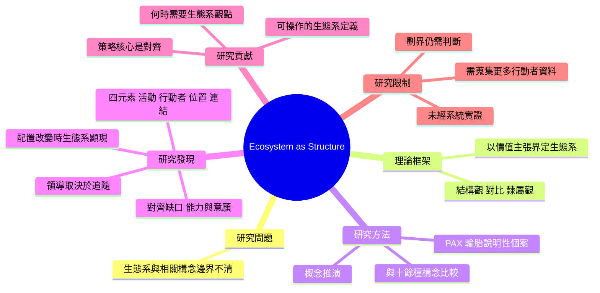

# 精讀卡（Reading Card）：Adner (2017)

## 書目（Reference, APA 7th）
Adner, R. (2017). Ecosystem as structure: An actionable construct for strategy. *Journal of Management, 43*(1), 39–58. https://doi.org/10.1177/0149206316678451

- 文章類型：概念／理論文章
- 來源性質：同儕審查期刊
- 研究傳統：不適用（以 Michelin PAX 個案作為說明例，非實證個案研究）
- 頁碼對應：PDF 第 1 頁＝期刊第 39 頁（差 38）
- 精讀日期：2026-10-18

> **年份提醒**：PDF 首頁同時印有「© The Author(s) 2016」（線上搶先版）與「Vol. 43 No. 1, January 2017 39–58」（正式卷期）。APA 7th 以正式卷期年份引用，故為 Adner (2017)；檔名與部分資料庫寫 2016，引用時請統一為 2017。

## 核心主張（Core claim）
生態系應以價值主張所需的活動結構來界定，其策略核心是夥伴對齊。

## 研究問題（Research question）
- 問題：「生態系」一詞在策略研究中被廣泛使用，但與平台、商業模式、網絡、供應鏈等相關構念的邊界不清，削弱了它的可用性 (pp. 39–40)。
- 作者如何論證缺口：【作者主張】作者逐一比較十餘種處理相互依存的既有構念，指出它們各自缺少「多邊、不可分解為雙邊關係的結構」與「對齊策略」這一塊 (pp. 49–53；Table 2, p. 54)，以此論證生態系即結構的觀點填補了概念空白。

## 理論框架（Theoretical framework）
- 主要理論：策略管理中的相互依存研究；作者提出「ecosystem-as-structure」相對於「ecosystem-as-affiliation」(pp. 40–41)。
- 對理論的動作：挑戰並重新界定。挑戰以行動者隸屬關係界定生態系的主流用法（Moore, 1996；Iansiti & Levien, 2004），提出以活動為中心的結構觀。

## 研究方法（Method）
| 項目 | 內容 | 頁碼 |
|---|---|---|
| 核心構念的定義與邊界 | 生態系：價值主張得以實現所需之多邊夥伴的對齊結構。生態系策略：焦點企業對齊夥伴並確保自身角色的方式 | pp. 42, 47 |
| 與既有構念的區別 | 與平台、多邊市場、網絡、商業模式、專案管理、供應鏈、產業結構等逐一比較 | pp. 49–53; Table 2, p. 54 |
| 推論邏輯 | 定義 → 四項結構元素 → 以 PAX 個案示範 → 推出策略意涵 → 與其他構念比較 → 界定適用邊界 | 全文 |
| 研究議程 | 價值分配、領導者與追隨者、協調與排序、制度與監管者的角色、衡量與資料蒐集的挑戰 | pp. 55–56 |
| 方法檢核結果 | 構念定義清楚、邊界條件明說；PAX 個案為說明用，細節引自 Adner (2013) 專書，非系統性資料 | pp. 56–57, 註 3 |

## 研究發現（Findings）
1. 【作者主張】兩種生態系觀點：affiliation 視生態系為以網絡與平台隸屬界定的行動者社群；structure 視生態系為由價值主張界定的活動配置。兩者概念有別但不互斥 (p. 40)。
2. 【作者主張】定義的四個成分：alignment structure、multilateral、set of partners、for a focal value proposition to materialize (pp. 42–43)。
3. 【作者主張】生態系結構的四項元素：activities、actors、positions、links (p. 43; Table 1, p. 44)。
4. 【作者主張】成熟產業中生態系多半是潛在的；當創新需要改變這些元素的配置時，生態系才會顯現 (p. 44)。
5. 【證據】PAX 輪胎個案：PAX 並未引進新行動者，但改變了位置與連結，使修車廠從潛在成員變成需要自行選擇是否採用設備的關鍵行動者 (pp. 44–47)。
6. 【作者主張】夥伴對齊的缺口有兩類來源：活動面（co-innovation risk、adoption chain risk）與期待面（對結構與對角色的期待）(pp. 47–48)。
7. 【作者主張】領導者是他人願意依從其結構與角色願景的企業；成功的領導取決於願意追隨者 (p. 48)。
8. 【作者主張】生態系觀點既非必要也非充分：只有當價值主張背後的多邊關係無法分解為雙邊關係時才有用 (pp. 53–55)。
9. 【作者主張】生態系邊界應以焦點價值主張與「需要被對齊的元素」來劃定，排除已就位且不需改變者 (p. 55)。

## 機制（Mechanism）
【作者主張】價值主張的實現依賴多個獨立行動者的活動。當價值主張要求某些行動者改變位置或建立新連結時，就出現對齊問題：這些行動者可能與焦點企業沒有直接關係，也沒有義務配合 (pp. 46–47)。因此成敗取決於能否辨識對齊缺口（能力不足、意願不足、對結構或角色的期待不一致），並創造條件彌合 (pp. 47–48)。不對稱的相互依存會使企業規模與權威失效，例如 Michelin 無法直接左右地方修車廠的選擇 (p. 49)。
【我的詮釋】作者的機制是「結構 → 對齊需求 → 策略」的邏輯推演，沒有說明對齊實際上透過哪些組織過程達成，這留給實證研究補足。

## 研究貢獻（Contributions）
- 理論貢獻：
  - 作者宣稱：提出生態系構念的明確定義、描述生態系結構的語法，以及生態系策略的特性 (p. 39)；釐清生態系構念相對於商業模式、平台、網絡等構念，在哪裡增加洞見、在哪裡沒有 (p. 39)；並提出策略研究的新問題 (p. 40)。
  - 【我的詮釋】實際貢獻：把「生態系」從比喻轉為可操作的分析單位（價值主張 → 活動 → 需對齊的行動者），並給出何時需要、何時不需要生態系觀點的判準 (pp. 53–55)。四項元素可直接作為實證研究的編碼架構。尚未經系統性實證檢驗。
- 實務貢獻：
  - 作者宣稱：有意義的生態系策略應明確評估並主動管理 co-innovation 與 adoption chain 兩類風險 (p. 48)。
  - 【我的詮釋】實際貢獻：管理者可用價值藍圖檢查「不在直接關係中、卻決定成敗」的夥伴，以及誰被期待擔任領導者；PAX 個案說明規模與權威無法取代對齊 (p. 49)。

## 研究限制（Limitations）
- 作者自述：
  - 若價值創造不需要調整多邊夥伴，生態系觀點沒有必要 (p. 53)。
  - 結構觀仍需研究者判斷如何劃界 (p. 55)。
  - 生態系研究需要蒐集更多行動者的資料與更深的情境知識 (p. 56)。
- 【我的詮釋】作者未提但值得注意：
  - 理論以營利企業與產品創新為主要情境，焦點企業的設定預設了某個主導者。
  - 概念文章，四項元素與兩類風險尚未經系統性實證檢驗。

## 論文心智圖（Mind map）

## 智慧標註清單（Highlights）
🟨 核心主張｜🟩 方法｜🟦 證據｜🟥 限制　（彩色標註 PDF：`Adner_2017_annotated.pdf`）

- 🟨 p. 39："This article presents a structuralist approach to conceptualizing the ecosystem construct." — 本文核心目的：以結構觀重新界定生態系構念。
- 🟥 p. 39："A consequence of this cornucopia of constructs, however, has been confusion regarding how these ideas relate to each other" — 作者論證的研究缺口：相關構念眾多但邊界不清。
- 🟨 p. 40："ecosystem-as-affiliation, which sees ecosystems as communities of associated actors defined by their networks and platform affiliations" — 兩種生態系觀點之一：隸屬觀（以行動者為中心）。
- 🟨 p. 40："ecosystem-as-structure, which views ecosystems as configurations of activity defined by a value proposition" — 作者採用的結構觀（以活動與價值主張為中心）。
- 🟨 p. 42："The ecosystem is defined by the alignment structure of the multilateral set of partners that need to interact in order for a focal value proposition to materialize." — 本文最常被引用的生態系定義 (p. 42)。
- 🟨 p. 42："Such cases illustrate the difference between participation and alignment." — 有參與不等於已對齊。
- 🟩 p. 43："Activities, which specify the discrete actions to be undertaken in order for the value proposition to materialize." — 四項結構元素之一：活動。可轉為質性編碼類別。
- 🟩 p. 43："Links, which specify transfers across actors." — 四項結構元素之四：連結（物資、資訊、影響力、資金）。
- 🟨 p. 44："It is when innovation requires a change in the configuration of these elements that the ecosystem becomes apparent" — 生態系在既有配置需要改變時才「顯現」。
- 🟦 p. 46："As a result, garages shifted from being latent members of the ecosystem to being actors whose participation would be a matter of their own choice." — PAX 個案：修車廠從潛在成員變成需自行選擇的關鍵行動者。說明性個案，非系統性資料。
- 🟩 p. 48："co-innovation risks, which relate to the challenge partners face in developing the ability to undertake the new activities" — 對齊風險一：夥伴能力不足。
- 🟩 p. 48："adoption chain risks, which relate to partners' willingness to undertake the required activities" — 對齊風險二：夥伴意願不足。
- 🟨 p. 48："Successful leadership is thus contingent on willing followership." — 領導權來自其他參與者的認可。
- 🟨 p. 49："If the heart of traditional strategy is the search for competitive advantage, the heart of ecosystem strategy is the search for alignment." — 生態系策略與傳統競爭策略的核心差異。
- 🟥 p. 53："Consideration of ecosystem strategy may not be necessary—and is never sufficient—to understand firms' actions, choice, and outcomes." — 適用邊界：生態系觀點既非必要也非充分。
- 🟥 p. 55："a critique of an ecosystem approach is that it risks drowning in the almost infinite web of interdependences" — 作者自承的限制：劃界困難。
- 🟥 p. 56："they also raise the challenge of capturing data on a broader set of actors than is the case in traditional strategy research" — 實證研究的資料蒐集挑戰，可對應自己研究的資料限制。

## 關鍵引文（Key quotes）
1. "The ecosystem is defined by the alignment structure of the multilateral set of partners that need to interact in order for a focal value proposition to materialize." (Adner, 2017, p. 42)
   → 可用來支持：生態系的操作型定義；本文最常被引用的定義。
2. "Such cases illustrate the difference between participation and alignment." (Adner, 2017, p. 42)
   → 可用來支持：「有參與」不等於「已對齊」，區分夥伴數量與夥伴對齊程度。
3. "It is when innovation requires a change in the configuration of these elements that the ecosystem becomes apparent" (Adner, 2017, p. 44)
   → 可用來支持：生態系在既有配置需要改變時才「浮現」的觀點。
4. "Successful leadership is thus contingent on willing followership." (Adner, 2017, p. 48)
   → 可用來支持：生態系領導權來自其他參與者的認可，而非單方面宣稱。
5. "If the heart of traditional strategy is the search for competitive advantage, the heart of ecosystem strategy is the search for alignment." (Adner, 2017, p. 49)
   → 可用來支持：生態系策略與傳統競爭策略的核心差異。
6. "its focus on the value proposition gives rise to a coherent set of decisions regarding where and how to draw the boundaries of the system" (Adner, 2017, p. 55)
   → 可用來支持：以價值主張劃定研究中生態系邊界的方法論依據。

> 二手引用提醒：Moore (1996, p. 26) 的生態系定義 (p. 41)、Iansiti & Levien (2004, p. 8) 的關鍵物種觀點 (p. 41) 皆為轉引。若要引用 affiliation 觀點的原始定義，請查原書。PAX 個案的完整描述在 Adner (2013) 第 1 章 (pp. 56–57, 註 3)。

## 與我的論文的關係（Relevance to my research）
> 本範例在 `my-research.md` 空白的情況下產出，因此只做通用評估。填寫該檔後，這一節會改為對應到你自己的章節。

| 面向 | 說明 |
|---|---|
| 適合支持的論點 | 生態系的操作型定義；「有參與不等於已對齊」；生態系在既有配置需要改變時才顯現；生態系策略的核心是對齊 |
| 適合放的位置 | 文獻探討中界定「生態系」構念、說明採用 structure 或 affiliation 觀點；研究方法中說明如何劃定研究對象的生態系邊界 |
| 方法參照 | 四項元素（activities、actors、positions、links）可轉為質性資料的編碼架構；以焦點價值主張劃界 (p. 55) |
| 延伸空間 | 對齊實際如何達成，文中只有邏輯推演；質性個案研究可補上對齊過程、角色期待與領導權形成的證據 |
| 可能衝突 | 若研究只是把某組織周邊的合作夥伴統稱為「生態系」，正是 Adner 批評的劃界方式 (p. 55)，需先界定焦點價值主張 |

整體判斷：核心文獻。

## 審稿人視角（Reviewer's view）
- 若引用這篇，評審可能質疑：
  - 引用 Adner 的結構觀，但資料若只呈現夥伴清單與合作數量，比較接近他批評的 affiliation 觀點，兩者是否一致？
  - Adner 的焦點企業是營利企業，以學校、非營利組織或政府單位為焦點行動者是否適用？
- 建議回應方式：
  - 在文獻探討明說採用哪一種觀點，並在研究方法中說明資料如何對應到四項結構元素。
  - 若資料難以直接觀察對齊程度，在研究限制中說明，並用其他資料來源三角檢定。

## 待查證清單（To verify）
- Moore (1996) 與 Iansiti & Levien (2004) 若要引用，需查原書與頁碼。
- 本卡 6 則引文已用 `scripts/verify_quotes.py` 比對 PDF，全部找到，頁碼換算無誤。
