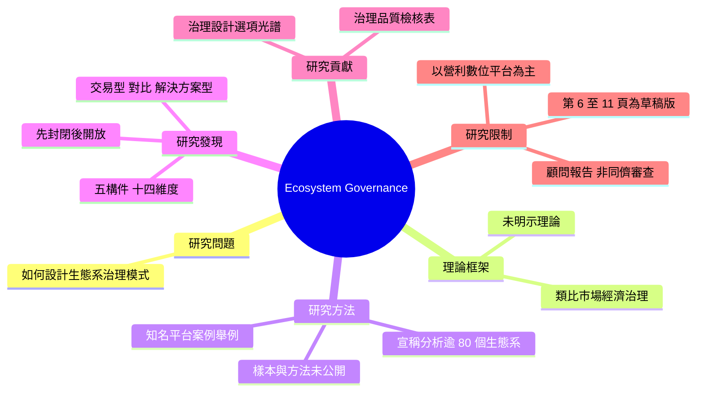

# 精讀卡（Reading Card）：Pidun (2021)

## 書目（Reference, APA 7th）
Pidun, U., Reeves, M., & Knust, N. (2021, January 20). *How do you manage a business ecosystem?* Boston Consulting Group. https://www.bcg.com/publications/2021/how-to-manage-business-ecosystem

- 文章類型：實務文章
- 來源性質：顧問報告（BCG Henderson Institute 系列文章第四篇；非同儕審查）
- 研究傳統：不適用
- 頁碼對應：PDF 頁序與印出頁碼相同（第 1 頁未印頁碼）
- 精讀日期：2026-10-18

> **版本警示**：本 PDF 第 6–11 頁頁首印有「EARLY DRAFT—INTERNAL BCG USE ONLY」，顯示這份檔案可能是內部草稿，而非正式發布版。已查到正式版：BCG 官網 2021 年 1 月 20 日發布（書目已更新）。正式網頁版把「不到 15%」的數據註明出自 MIT Sloan Management Review 刊登的研究，草稿版只寫「our research」；引用這個數據時請依正式版標示來源。網頁版沒有頁碼，APA 引用可改用小節標題定位；官網提供 PDF 下載，若改用正式版 PDF，請重新核對頁碼。

## 核心主張（Core claim）
生態系失敗多源於治理模式；治理需在五個構件上依策略優先順序做開放或封閉的選擇。

## 研究問題（Research question）
- 問題：生態系的協調者（orchestrator）與夥伴如何設計一套能達成價值創造、風險管理與價值分配三項目標的治理模式？(pp. 2–3)
- 作者如何論證缺口：【作者主張】作者以自家研究稱長期能持續的生態系不到 15%，最常見的失敗原因是治理模式薄弱 (p. 1)；並以多個失敗案例（過度開放、過度封閉、無法約束不當行為、夥伴衝突、法規或消費者反彈）說明治理失靈的型態 (pp. 1–2)。此「15%」數據未交代樣本與方法。

## 理論框架（Theoretical framework）
- 主要理論：未明示理論立場。概念上接近平台治理（platform governance）與市場經濟治理的類比 (p. 2)；註腳引用 Boudreau & Hagiu、Parker & Van Alstyne 等平台研究 (p. 10)。
- 對理論的動作：應用與彙整。將治理拆成可操作的設計選項，未提出新理論。

## 研究方法（Method）
| 項目 | 內容 | 頁碼 |
|---|---|---|
| 作者與出版機構 | BCG 合夥人、BCG Henderson Institute 主席與顧問；BCG 出版 | p. 11 |
| 論點依據 | 宣稱分析逾 80 個跨領域商業生態系的治理；以知名平台（Uber、Apple、Wikipedia、Kiva、SAP 等）作例 | p. 3 |
| 樣本與方法是否公開 | 否。80 個生態系的名單、選取標準、編碼方式、「成功」的判準皆未說明 | — |
| 商業立場 | 顧問公司思想領導（thought leadership）文章，具推廣顧問框架的動機 | p. 11 |
| 方法檢核結果 | 適合引用為實務現象與分類架構的來源；不宜作為因果主張或理論依據 | — |

## 研究發現（Findings）
1. 【作者主張】治理模式的定義：明示或隱含的結構、規則與實務，用以框定並治理生態系參與者的行為與互動 (p. 2)。
2. 【作者主張】治理需同時達成三項目標：支持價值創造、管理風險、優化價值分配 (p. 3)。
3. 【作者主張】治理框架由五個構件、14 個維度組成 (p. 3, Exhibit 1)：
   - Mission（purpose、culture）
   - Access（entry、commitment）
   - Participation（decision rights、transparency、conflict management）
   - Conduct（input / process / output control）
   - Sharing（data rights、property rights、value distribution）
4. 【作者主張】每個維度有一組由開放到封閉的選項 (p. 9, Exhibit 2)。
5. 【作者主張】良好治理的四項特性：consistency、fairness、effectiveness、flexibility (pp. 8–9; Exhibit 3, p. 10)。
6. 【證據】作者觀察到交易型生態系多採開放進入、集中決策、嚴格行為管控；解決方案型生態系較選擇性進入、以共同目的對齊、要求較高承諾，並給夥伴較多決策權 (p. 9)。（依據未公開的 80 個樣本）
7. 【作者主張】治理需隨時間演進：許多成功平台先封閉以建立品質與行為規範，再隨成長逐步開放 (p. 10)。

## 機制（Mechanism）
【作者主張】生態系建立在獨立主體的自願合作之上，協調者無法用層級控制，只能說服夥伴加入與合作 (p. 2)；因此治理的作用是「促成」而非「管理」，類比市場經濟中避免市場失靈的制度 (pp. 2–3)。共同使命可降低對細部規則的依賴 (p. 4)；進入與承諾設計決定夥伴組成與投入；參與、行為與分享規則則分別處理協調、品質與誘因。
【我的詮釋】作者沒有說明五個構件之間如何互相作用（例如強使命是否能替代嚴格的行為管控），機制停留在「各構件各自處理一類問題」的層次。

## 研究貢獻（Contributions）
- 理論貢獻：
  - 作者宣稱：無。本文定位為實務指引，未宣稱理論貢獻。
  - 【我的詮釋】實際貢獻：提供生態系治理設計的描述性分類（五構件、14 維度、各維度由開放到封閉的選項，Exhibit 1–2, pp. 3, 9），可作為建構理論時的分類參考；沒有提出新的理論解釋。
- 實務貢獻：
  - 作者宣稱：建立平台或生態系的企業可用本文框架系統性思考治理選項；考慮加入生態系的企業可據以評估其治理的一致性、公平、效能與彈性 (p. 10)。
  - 【我的詮釋】實際貢獻：Exhibit 2 的選項光譜與 Exhibit 3 的檢核表 (p. 10) 可直接當成治理診斷工具。

## 研究限制（Limitations）
- 作者自述：治理模式的選擇取決於生態系類型（交易型或解決方案型）與策略優先順序（成長探索或品質利用）(pp. 9–10)；治理不是靜態的 (p. 10)。
- 【我的詮釋】作者未提但值得注意：
  - 案例幾乎都是營利型數位平台，對非營利或教育型生態系的適用性未經檢驗。
  - 「成功」的判準未定義，交易型與解決方案型的對比可能有倖存者偏誤。
  - 框架以單一協調者為中心，較不適用於沒有明確主導者的多中心生態系。

## 論文心智圖（Mind map）

## 智慧標註清單（Highlights）
🟨 核心主張｜🟩 方法｜🟦 證據｜🟥 限制　（彩色標註 PDF：`Pidun_2021_annotated.pdf`）

- 🟦 p. 1："less than 15% of business ecosystems are sustainable in the long run" — 顧問研究數據，樣本與方法未公開；只宜作為背景。
- 🟨 p. 1："the most prevalent reason for failure is weakness in the governance model" — 核心主張：生態系失敗主因是治理模式薄弱。
- 🟨 p. 2："the set of explicit or implicit structures, rules, and practices that frame and govern the behavior and interplay of participants in a business ecosystem" — 生態系治理的定義，涵蓋正式規則與非正式實務。
- 🟨 p. 2："Instead of exerting hierarchical control, the orchestrator must convince partners to join and collaborate in the ecosystem." — 機制：協調者無層級權力，只能說服。
- 🟩 p. 3："Drawing on our analysis of the governance of more than 80 business ecosystems from various domains" — 論點依據：80+ 生態系分析，但名單、選取標準與編碼方式皆未公開。
- 🟨 p. 3："The framework covers the five main building blocks that must be used in managing a business ecosystem" — 五構件：Mission、Access、Participation、Conduct、Sharing。
- 🟦 p. 6："The majority of ecosystems we investigated, however, are mostly not transparent." — 觀察結果（草稿頁）；樣本未公開。
- 🟦 p. 9："many successful transaction ecosystems opt for a rather open access model" — 交易型生態系的治理型態（草稿頁）。
- 🟦 p. 9："many successful solution ecosystems that we investigated are more selective in granting access to the ecosystem" — 解決方案型生態系的治理型態（草稿頁）；「成功」的判準未定義。
- 🟨 p. 10："many successful platforms start with a rather closed approach to establish the right quality and behavior but then scale up and open up as the ecosystem grows" — 治理隨發展階段由封閉轉向開放（草稿頁，需核對正式版）。
- 🟥 p. 10："ecosystem governance is not static; it must be actively developed over time" — 邊界條件：治理需隨時間調整，靜態框架有其限制。

## 關鍵引文（Key quotes）
1. "less than 15% of business ecosystems are sustainable in the long run" (Pidun et al., 2021, p. 1)
   → 可用來支持：生態系建構失敗率高、治理值得研究。但這是顧問研究數據、方法未公開，只宜放在緒論作背景，並註明來源性質。
2. "the set of explicit or implicit structures, rules, and practices that frame and govern the behavior and interplay of participants in a business ecosystem" (Pidun et al., 2021, p. 2)
   → 可用來支持：界定「生態系治理」的操作型定義，涵蓋正式規則與非正式實務。
3. "The role of the orchestrator is not to manage but to enable the other players and to act as the steward of the ecosystem." (Pidun et al., 2021, pp. 2–3)
   → 可用來支持：協調者角色從控制轉向賦能的論點。
4. "Drawing on our analysis of the governance of more than 80 business ecosystems from various domains" (Pidun et al., 2021, p. 3)
   → 可用來說明：框架的經驗基礎與其限制（樣本未公開）。
5. "many successful platforms start with a rather closed approach to establish the right quality and behavior but then scale up and open up as the ecosystem grows" (Pidun et al., 2021, p. 10)
   → 可用來支持：治理隨生態系發展階段由封閉轉向開放的演化觀點。注意此頁屬草稿頁，需核對正式版。

> 二手引用提醒：文中引用 Boudreau & Hagiu (2009) 談社群價值觀 (p. 4)、Parker & Van Alstyne (2017) 談 SAP 的限時產權 (p. 8)。若要使用這些論點，請查原始文獻。

## 與我的論文的關係（Relevance to my research）
> 本範例在 `my-research.md` 空白的情況下產出，因此只做通用評估。填寫該檔後，這一節會改為對應到你自己的章節。

| 面向 | 說明 |
|---|---|
| 適合支持的論點 | 生態系失敗常與治理有關（作為背景，需註明顧問數據）；治理包含正式規則與非正式實務；治理可隨發展階段由封閉轉向開放 |
| 適合放的位置 | 文獻探討中「生態系治理」的實務觀點；研究方法中作為編碼架構的參考（五構件 14 維度，需說明改編理由） |
| 延伸空間 | 框架以營利數位平台、單一協調者為主；若你的研究對象是非營利、教育或多中心的生態系，可檢驗哪些維度成立、哪些需修正 |
| 不適合 | 作為理論依據或實證證據（樣本與方法未公開） |

整體判斷：輔助引用＋方法參考。

## 審稿人視角（Reviewer's view）
- 若引用這篇，評審可能質疑：
  - 顧問報告非同儕審查，「15%」與「80 個生態系」的數據方法不明。
  - 商業平台框架移植到其他情境（例如非營利、教育、公部門）的適切性。
  - 引用的是內部草稿版本。
- 建議回應方式：
  - 只把本文當作分類架構與實務佐證，理論依據改用同儕審查的生態系研究。
  - 若借用框架編碼，在研究方法中說明改編步驟與理由。
  - 引用正式發布版。

## 待查證清單（To verify）
- 正式版 PDF 的頁碼（網頁版已確認：2021 年 1 月 20 日；現有 PDF 第 6–11 頁為草稿）。
- 「不到 15%」所引的 MIT Sloan Management Review 原始研究。
- 引文 5 在正式版中的文字與頁碼是否一致。
- 註腳 1、6 的原始文獻（Boudreau & Hagiu, 2009；Parker & Van Alstyne, 2017）。
