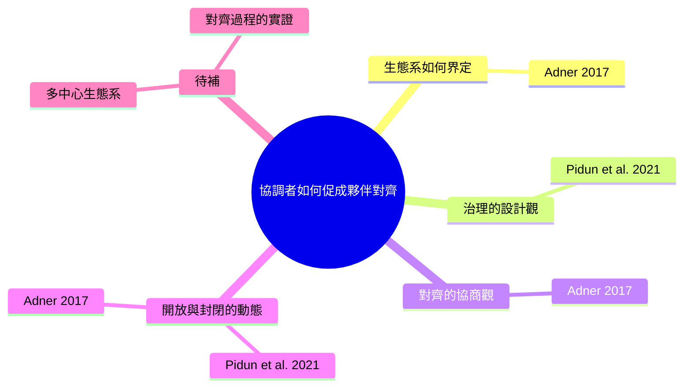

# 文獻探討論證大綱：商業生態系的治理與對齊

- 研究問題（測試用示範）：協調者如何透過治理設計，促成生態系夥伴的對齊？
- 整體論證：生態系的成敗取決於能否讓獨立夥伴對齊；既有文獻分別從「規則設計」與「對齊協商」切入，但兩者如何銜接、在沒有單一主導者時如何運作，仍缺乏實證。

> 文獻量警示：只有 2 篇，以下為初步架構；每一節都需要補讀後再定稿。

## 文獻地圖

## 章節結構

### 2.1 生態系的界定：從夥伴集合到對齊結構
- 這一節要讓讀者相信：研究生態系前，必須先界定焦點價值主張，否則構念會失焦。
- 主要文獻：（Adner, 2017）（單一來源，需補讀）
- 段落安排：
  1. 主題句：生態系有兩種界定方式，隸屬觀以行動者網絡為中心，結構觀以價值主張所需的活動為中心。｜文獻：（Adner, 2017, pp. 40–42）｜功能：建立背景
  2. 主題句：以價值主張劃界，可以避免把組織周邊所有夥伴都稱為生態系。｜文獻：（Adner, 2017, p. 55）｜功能：界定本研究的分析單位
- 銜接：界定之後的問題是，如何讓結構中的獨立夥伴一起行動。

### 2.2 讓夥伴一起行動的兩種觀點：治理設計與對齊協商
- 這一節要讓讀者相信：文獻對「如何讓夥伴一起行動」有兩種假設，兩者尚未整合。
- 主要文獻：（Pidun et al., 2021; Adner, 2017）
- 段落安排：
  1. 主題句：設計觀把治理視為協調者訂定的明示與隱含規則，涵蓋使命、進入、參與、行為規範與分享。｜文獻：（Pidun et al., 2021, pp. 2–3）｜功能：介紹觀點一
  2. 主題句：協商觀強調對齊需要夥伴同意其位置與角色，領導權來自追隨者的接受。｜文獻：（Adner, 2017, pp. 47–48）｜功能：介紹觀點二
  3. 主題句：兩種觀點的差異來自寫作目的與分析單位不同，但都同意協調者無法單靠層級權力。｜文獻：（Pidun et al., 2021, p. 2；Adner, 2017, p. 49）｜功能：比較觀點、指出共識與分歧
- 銜接：兩種觀點都把治理放在時間之中，下一節看治理如何隨發展階段改變。

### 2.3 治理的動態：何時封閉、何時開放
- 這一節要讓讀者相信：治理與對齊不是一次性的設計，而是隨生態系發展而調整，但調整過程缺乏證據。
- 主要文獻：（Pidun et al., 2021; Adner, 2017）
- 段落安排：
  1. 主題句：實務觀察指出，成功平台多先封閉以建立品質，再隨成長開放。｜文獻：（Pidun et al., 2021, p. 10）（實務文章，降調用詞）｜功能：建立背景
  2. 主題句：生態系在配置需要改變時才顯現，對齊問題也在此時浮上檯面。｜文獻：（Adner, 2017, p. 44）｜功能：提供理論解釋
- 銜接：既有文獻提出了動態主張，但沒有提供過程證據。

### 2.4 研究缺口與研究問題
- 由前面各節推出的缺口：初步觀察 1（設計與協商未整合）、2（缺乏對齊過程的實證）、3（單一焦點行動者的前提）。
- 研究問題：協調者如何透過治理設計，促成生態系夥伴的對齊？

## 建議補讀
| 文獻或主題 | 為什麼需要 | 來源 |
|---|---|---|
| Moore (1996) | 隸屬觀的原始定義；2.1 目前只有轉引 | Adner, 2017, p. 41 轉引；待查證 |
| Iansiti & Levien (2004) | 隸屬觀的關鍵物種概念 | Adner, 2017, p. 41 轉引；待查證 |
| Gawer & Henderson (2007) | 平台領導者如何確保追隨者位置，可補 2.2 的協商觀 | Adner, 2017, pp. 48–49 轉引；待查證 |
| O'Mahony & Ferraro (2007) | 開源社群中治理如何浮現，可補多中心情境 | Adner, 2017, p. 57 註 5 轉引；待查證 |
| 生態系治理的實證研究 | 目前 0 篇實證，需補質性或量化研究 | 待檢索 |
| 非營利或教育情境的生態系研究 | 情境覆蓋度為零 | 待檢索 |
